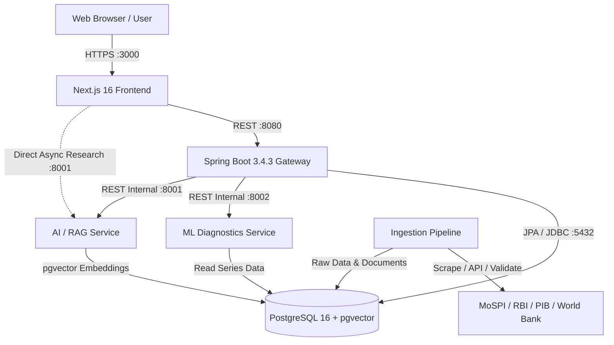

# ArthaLens 🇮🇳

> **Sovereign Macroeconomic Intelligence Platform for India**  
> Transparent, provenance-first analysis of India's national accounts and economic data with strict series isolation, statistical diagnostics, and citation-grounded AI research.

[](https://adoptium.net/)
[](https://spring.io/projects/spring-boot)
[](https://nextjs.org/)
[](https://react.dev/)
[](https://www.python.org/)
[](https://www.postgresql.org/)
[](https://flywaydb.org/)
[](./BUILD_LOG.md)
[](./LICENSE)

---

## 📖 Table of Contents

- [Overview & Vision](#-overview--vision)
- [Key Features](#-key-features)
- [System Architecture](#-system-architecture)
- [Technology Stack](#-technology-stack)
- [Official Data Sources & Governance](#-official-data-sources--governance)
- [API Endpoints Reference](#-api-endpoints-reference)
- [System Requirements](#-system-requirements)
- [Installation & Quickstart Guide](#-installation--quickstart-guide)
  - [Option A: Docker Compose (Recommended)](#option-a-docker-compose-recommended)
  - [Option B: Local Native Development](#option-b-local-native-development)
- [Environment Configuration (`.env`)](#-environment-configuration-env)
- [Data Ingestion & Document Indexing](#-data-ingestion--document-indexing)
- [Testing & Quality Verification](#-testing--quality-verification)
- [Documentation Directory](#-documentation-directory)

---

## 🌟 Overview & Vision

India's economic data landscape is rich, comprehensive, and continuously evolving. However, understanding Indian macroeconomic data has historically suffered from:
1. **Unintended Series Mixing**: Inadvertently mixing Base Year 2011-12 and 2022-23 estimates without methodology adjustment.
2. **Opaque Revisions**: Difficulty tracking how GDP estimates evolve from First Advance Estimates (FAE) to Third Revised Estimates (TRE).
3. **Deflator Divergence**: Confusing gaps between the GDP Implicit Price Deflator, CPI, and WPI indices.
4. **Lack of Provenance**: Economic claims circulated without cryptographic or document-level citations to official releases.
5. **AI Hallucinations**: Generic LLMs fabricating statistics, mixing real and nominal metrics, or offering speculative investment advice.

**ArthaLens** solves these challenges by providing a **zero-mock, provenance-first intelligence platform**. Every data point is traced directly to primary publications from the Ministry of Statistics & Programme Implementation (MoSPI), Reserve Bank of India (RBI), Press Information Bureau (PIB), State Directorates of Economics and Statistics (DES), and international authorities.

---

## 🚀 Key Features

### 1. 📊 Composite Macroeconomic Dashboard (`/`)
- **Key National Indicators**: Real GDP Growth (YoY %), Nominal GDP Growth (YoY %), Annual Absolute Nominal GDP (₹ Lakh Crore / USD Billions), and Real Gross Value Added (GVA).
- **Price & Monetary Metrics**: Headline CPI Combined (MoSPI), Wholesale Price Index (DPIIT), RBI Repo Rate, Fiscal Deficit (% of GDP), and Foreign Exchange Reserves (USD Bn).
- **High-Frequency Proxies**: Index of Industrial Production (IIP), Manufacturing & Services PMI, GST Revenue Collections, and Non-Food Bank Credit Growth.
- **Strict Base-Year Toggle**: Instant toggle between Base Year `2011-12` and `2022-23` with isolated schemas preventing silent contamination.
- **Live News & Release Ticker**: Timely updates on official releases and statistical announcements.

### 2. 📈 National GDP & State GSDP Explorer (`/gdp`, `/gdp/why`)
- **Historical Time Series**: Comprehensive quarterly (`Q1`-`Q4`) and financial year (`FY`) series across decades.
- **Price Type Controls**: Seamless switching between Constant (Real) and Current (Nominal) prices.
- **Sub-National Accounts**: State-level GSDP and GSVA for 15+ major Indian states and union territories (`/gdp/states`).
- **Growth Drivers & GVA Decomposition (`/gdp/why`)**: Sectoral contribution to growth (Agriculture, Industry, Services) and demand-side breakdown (PFCE, GFCE, GFCF, Net Exports).
- **Accessible Visualizations**: Interactive ECharts with accessible, downloadable data table fallbacks.

### 3. 🔬 Methodology & Rebasing Explorer (`/methodology`)
- **Base Year Series Comparison**: Side-by-side methodology diff between 2011-12 and upcoming 2022-23 series.
- **Structural Explanations**: Deep-dives into the MCA-21 database transition, double deflation vs single deflation in manufacturing, and ASI sample rebasing.
- **Official Documentation**: Links to methodology manuals, national accounts advisory committee papers, and metadata.

### 4. 🧮 Deflator & Inflation Diagnostics Lab (`/deflator`)
- **Implicit Price Deflator (IPD)**: Real-time tracking of the GDP and GVA deflators.
- **Cross-Index Triangulation**: Triangulates the GDP Deflator against Headline CPI and WPI to detect inflation divergences.
- **Identity Residual Verification**: Verifies the mathematical identity:
  $$\text{GDP Deflator} = \frac{\text{Nominal GDP}}{\text{Real GDP}} \times 100$$
  Flags mathematical residuals and structural wedge explanations for research review.

### 5. 🔄 MoSPI Revision Tracker (`/revisions`)
- **Lifecycle Tracking**: Visualizes the revision cycle from First Advance Estimate (FAE) $\rightarrow$ Second Advance Estimate (SAE) $\rightarrow$ Provisional Estimate (PE) $\rightarrow$ First Revised Estimate (FRE) $\rightarrow$ Second Revised (SRE) $\rightarrow$ Third Revised (TRE).
- **Statistical Analytics**: Computes historical revision bias, Mean Absolute Revision (MAR %), Maximum Upward/Downward adjustments, and directional consistency.

### 6. 🧠 ML Macroeconomic Consistency Analyzer (`/consistency`)
- **Transparent 0–100 Co-Movement Score**: Evaluates whether published GDP figures align with underlying physical and monetary proxies (IIP, GST, PMI, Credit, Exports).
- **Rolling Correlation Matrices**: Calculates rolling Pearson correlations across user-specified time horizons.
- **Strict Analytical Guardrails**: Formally designated as an **analytical diagnostic / research aid** — never framed as an authoritative "truth score".

### 7. 🏛️ Sovereign Ratings & Risk Observatory (`/ratings`)
- **Agency Coverage**: Multi-decade rating actions, assessments, and outlook histories from Moody's, S&P Global, and Fitch Ratings.
- **Investment-Grade Benchmarks**: Visualizes India's sovereign position relative to the investment-grade threshold (`BBB-` / `Baa3`).
- **Audit History**: Historical audit trail documenting upgrades, downgrades, and outlook revisions with official rationale.

### 8. 🔍 Source Provenance & Document Audit (`/sources`, `/sources/[id]`)
- **Immutable Provenance Registry**: Detailed metadata for all official sources (MoSPI NAS, RBI DBIE, PIB, Office of Economic Adviser, World Bank).
- **Metadata Fields**: Publication timestamp, data frequency, revision policy, official canonical URL, SHA-256 document checksum, and ingestion status.

### 9. 🤖 Citation-Grounded AI Research Assistant (`/ai`)
- **Provider-Agnostic LLM Engine**: Native support for OpenAI (`gpt-4o`), Anthropic Claude, Google Gemini, and local Ollama (`llama3`).
- **pgvector Semantic Search**: High-density vector embeddings of official government publications, press releases, and methodology papers.
- **Security & Safety Guardrails**:
  - Prompt injection and system jailbreak defense.
  - Strict Anti-SSRF protection allowing egress only to approved official `.gov.in` and `.nic.in` domains.
  - PII redaction and citation validation (every claim maps to an indexed official document).
  - **Zero Investment Advice**: Refuses queries regarding speculative stock buying/selling or portfolio allocation.

### 10. 🌐 Global Observatory (`/observatory`, `/global`)
- Integrates World Bank Open Data to benchmark India's GDP growth, per capita income, and inflation against G20 and emerging market peers.

---

## 🏗️ System Architecture

```
arthalens/
├── apps/
│   └── web/                     # Next.js 16 App Router + React 19 + Tailwind CSS v4 + ECharts
├── services/
│   ├── api/                     # Spring Boot 3.4.3 REST API (Java 21, Flyway, Hibernate, Actuator)
│   ├── ingestion/               # Python 3.11+ data pipeline (MoSPI, RBI, PIB adapters, validation)
│   ├── ml/                      # Python 3.11+ FastAPI (Consistency scoring, ARIMA, correlations)
│   ├── ai/                      # Python 3.11+ FastAPI (RAG pipeline, pgvector, prompt security)
│   └── database/                # Flyway SQL migrations (V1–V11) + seed datasets
├── packages/
│   └── contracts/openapi/       # OpenAPI 3.1 specification (arthalens-api.yaml)
├── infra/
│   ├── docker-compose.yml       # Production-ready multi-service compose configuration
│   └── docker/                  # Service Dockerfiles and startup scripts
└── docs/                        # Architecture, data dictionary, model cards, threat model
```

### Component Interaction Topology



---

## 💻 Technology Stack

| Domain | Technology | Version | Purpose |
|---|---|---|---|
| **Frontend** | Next.js | `16.3.4` | App Router, React Server & Client Components |
| | React | `19.2.8` | UI Library |
| | TypeScript | `5.x` | Strict type-safety across all components |
| | Tailwind CSS | `4.x` | Modern styling with OKLCH color palettes |
| | Apache ECharts | `6.1.0` | Accessible, responsive macroeconomic charting |
| | TanStack Query | `5.x` | Server-state caching, deduplication, and retry logic |
| **Backend API** | Java | `21 (LTS)` | Runtime environment (Eclipse Temurin / OpenJDK) |
| | Spring Boot | `3.4.3` | High-throughput REST API framework |
| | Spring Data JPA | `3.4.3` | Database persistence and repository layer |
| | Flyway | `10.x` | Schema migration version control (V1–V11) |
| | SpringDoc OpenAPI | `2.8.5` | Automated OpenAPI 3.1 generation and Swagger UI |
| **ML Service** | Python | `3.11+` | Statistical diagnostics & forecasting runtime |
| | FastAPI | `0.115+` | High-performance asynchronous REST microservice |
| | Pandas & NumPy | `2.2+` | Time-series data manipulation |
| | Statsmodels & SciPy | `0.14+` | ARIMA modeling & rolling correlation analysis |
| **AI / RAG Service** | FastAPI & Uvicorn | `0.115+` | Citation-first conversational research assistant |
| | pgvector | `0.7+` | Vector similarity search inside PostgreSQL |
| | Pluggable LLMs | — | OpenAI (`gpt-4o`), Anthropic, Google Gemini, Ollama |
| **Ingestion** | HTTPX | `0.27+` | HTTP/2 resilient web and API client with exponential backoff |
| | APScheduler | `3.10+` | Scheduled ingestion workflows |
| **Database** | PostgreSQL | `16` | Relational storage + vector store (`pgvector`, `uuid-ossp`) |
| **DevOps & Infra** | Docker Compose | `v2.20+` | Local container orchestration |
| | GitHub Actions | — | Continuous integration: linting, typing, unit & integration tests |

---

## 🏛️ Official Data Sources & Governance

ArthaLens operates under a **zero-fabrication policy**. Data is ingested from the following verified authorities:

| Authority | Coverage & Metrics | Update Cadence | Canonical Endpoint |
|---|---|---|---|
| **MoSPI (CSO/NAD)** | Real/Nominal GDP, GVA at Basic Prices, Sectoral Output, GDP Deflator | Quarterly (Feb, May, Aug, Nov) | [mospi.gov.in](https://mospi.gov.in) |
| **MoSPI (FOD)** | Consumer Price Index (CPI Combined, Rural, Urban, Core) | Monthly (12th of month) | [mospi.gov.in/cpi](https://mospi.gov.in/cpi) |
| **Office of Economic Adviser (DPIIT)** | Wholesale Price Index (WPI All Commodities, Primary, Fuel, Mfg) | Monthly (14th of month) | [eaindustry.nic.in](https://eaindustry.nic.in) |
| **Reserve Bank of India (RBI DBIE)** | Policy Rates, Banking Statistics, FX Reserves, Monetary Aggregates | Weekly / Fortnightly / Monthly | [dbie.rbi.org.in](https://dbie.rbi.org.in) |
| **State DES & MoSPI (SDP)** | Gross State Domestic Product (GSDP), State GVA for 15+ States/UTs | Annual | [mospi.gov.in](https://mospi.gov.in) |
| **PIB (Govt. of India)** | Official Ministry Press Releases, Advance Estimates, Revisions | Event-driven | [pib.gov.in](https://pib.gov.in) |
| **World Bank Open Data** | Global macroeconomic benchmarks (GDP current USD, GDP growth) | Periodic | [worldbank.org](https://data.worldbank.org) |
| **Sovereign Rating Agencies** | S&P Global, Moody's, Fitch Ratings sovereign ratings & outlooks | Event-driven / Semi-annual | Official Agency Bulletins |

---

## 🔌 API Endpoints Reference

### 1. Spring Boot Core API (`http://localhost:8080`)
Interactive documentation: [Swagger UI](http://localhost:8080/swagger-ui.html) | [OpenAPI Spec](http://localhost:8080/v3/api-docs)

| Domain | Method | Path | Description |
|---|---|---|---|
| **Dashboard** | `GET` | `/api/v1/dashboard/india` | Composite India economic snapshot (GDP, GVA, CPI, Repo, FX) |
| **GDP** | `GET` | `/api/v1/gdp/latest` | Latest official GDP observation by base year (`2011-12`, `2022-23`) |
| **GDP** | `GET` | `/api/v1/gdp/series` | Historical GDP time series with strict isolation parameters |
| **GDP** | `GET` | `/api/v1/gdp/sectors` | Sectoral GVA breakdown across the 8 key industrial sectors |
| **GDP** | `GET` | `/api/v1/gdp/revisions` | Revision tracking across official MoSPI estimate releases |
| **GDP / States** | `GET` | `/api/v1/gdp/states` | Sub-national Gross State Domestic Product (GSDP) & GSVA |
| **Methodology** | `GET` | `/api/v1/methodology/series-comparison` | Base Year 2011-12 vs 2022-23 methodology diff |
| **Deflators** | `GET` | `/api/v1/deflators` | Implicit GDP deflator, CPI, and WPI historical series |
| **Indicators** | `GET` | `/api/v1/indicators` | High-frequency economic indicators (IIP, PMI, GST, Credit) |
| **Ratings** | `GET` | `/api/v1/ratings` | Sovereign credit ratings & outlooks (Moody's, S&P, Fitch) |
| **Sources** | `GET` | `/api/v1/sources` | Complete catalog of ingested official sources |
| **Sources** | `GET` | `/api/v1/sources/{id}` | Source provenance, publication details, and audit metadata |
| **AI / RAG** | `POST` | `/api/v1/ai/query` | Backend-orchestrated citation-grounded research Q&A |
| **Health** | `GET` | `/api/v1/health` | Service health status and database connectivity |

### 2. Python ML Microservice (`http://localhost:8002`)
Interactive documentation: [FastAPI Docs](http://localhost:8002/docs)

| Method | Path | Description |
|---|---|---|
| `POST` | `/ml/v1/consistency-score` | Computes 0–100 macroeconomic consistency score with sub-weights |
| `POST` | `/ml/v1/sector-contributions` | Calculates sector GVA shares and contributions to growth |
| `POST` | `/ml/v1/rolling-correlations` | Computes rolling Pearson correlation between GDP and proxies |
| `POST` | `/ml/v1/revision-analytics` | Computes revision magnitude, mean revision bias, and directionality |
| `POST` | `/ml/v1/deflator-check` | Tests nominal/real GDP identity and flags index divergences |
| `GET` | `/health` | Microservice liveness and health |

### 3. Python AI / RAG Microservice (`http://localhost:8001`)
Interactive documentation: [FastAPI Docs](http://localhost:8001/docs)

| Method | Path | Description |
|---|---|---|
| `POST` | `/ai/v1/query` | Executes RAG pipeline with pgvector semantic retrieval and citation validation |
| `GET` | `/health` | Microservice health check |

---

## 📋 System Requirements

Ensure your workstation meets the following prerequisites before installation:

| Tool | Version Requirement | Verification Command | Notes |
|---|---|---|---|
| **Operating System** | Linux, macOS, or Windows (WSL2 / PowerShell) | — | Cross-platform |
| **Docker & Compose** | Docker 24+ / Compose v2.20+ | `docker --version` | Required for containerized setup |
| **Java JDK** | Java 21 (LTS) | `java --version` | Eclipse Temurin, OpenJDK, or GraalVM |
| **Python** | Python 3.11, 3.12, or 3.13 | `python --version` | Required for Ingestion, ML, and AI |
| **Node.js** | Node.js 20.x or 22.x LTS | `node --version` | Required for Next.js frontend |
| **npm** | npm 10+ | `npm --version` | Frontend package manager |
| **PostgreSQL** (Native) | PostgreSQL 16 with `pgvector` | `psql --version` | Only if running database outside Docker |
| **Git** | 2.40+ | `git --version` | Version control |

---

## 🛠️ Installation & Quickstart Guide

### Option A: Docker Compose (Recommended)

The simplest way to run the entire ArthaLens platform (PostgreSQL, Spring Boot API, ML service, AI service, and Next.js frontend) in isolated containers:

```bash
# 1. Clone the repository
git clone https://github.com/your-org/arthalens.git
cd arthalens

# 2. Configure environment variables
cp .env.example .env
# Edit .env and configure POSTGRES_PASSWORD and LLM API keys (e.g., OPENAI_API_KEY)

# 3. Start PostgreSQL first
docker-compose -f infra/docker-compose.yml up -d postgres

# 4. Apply database seeds
# Windows (PowerShell):
docker exec -i arthalens_postgres psql -U arthalens -d arthalens < services/database/seeds/seed_sources.sql
docker exec -i arthalens_postgres psql -U arthalens -d arthalens < services/database/seeds/seed_methodology.sql

# Linux / macOS:
docker-compose -f infra/docker-compose.yml exec -T postgres psql -U arthalens -d arthalens < services/database/seeds/seed_sources.sql
docker-compose -f infra/docker-compose.yml exec -T postgres psql -U arthalens -d arthalens < services/database/seeds/seed_methodology.sql

# 5. Build and launch all services
docker-compose -f infra/docker-compose.yml up -d --build

# 6. Verify running services
docker-compose -f infra/docker-compose.yml ps
```

The application is now accessible at:
- **Frontend Dashboard**: [http://localhost:3000](http://localhost:3000)
- **Spring Boot API**: [http://localhost:8080/swagger-ui.html](http://localhost:8080/swagger-ui.html)
- **ML Diagnostics API**: [http://localhost:8002/docs](http://localhost:8002/docs)
- **AI / RAG Service**: [http://localhost:8001/docs](http://localhost:8001/docs)

---

### Option B: Local Native Development

For developers working directly on service source code:

#### Step 1: Environment Setup
```bash
cp .env.example .env
# Set POSTGRES_PASSWORD, LLM_PROVIDER, and appropriate API keys
```

#### Step 2: Start PostgreSQL with pgvector
Start the database container using Docker Compose:
```bash
docker-compose -f infra/docker-compose.yml up -d postgres
```
*(Alternatively, point `POSTGRES_HOST` in `.env` to a local PostgreSQL 16 instance with `pgvector` installed).*

#### Step 3: Run Spring Boot API & Flyway Migrations
The Spring Boot service runs Flyway migrations (`V1` through `V11`) automatically on startup:
```bash
cd services/api

# Linux / macOS:
./mvnw clean spring-boot:run

# Windows:
.\mvnw.cmd clean spring-boot:run
```
*API will start on `http://localhost:8080`.*

#### Step 4: Seed Database Master Records
In a separate terminal, seed the official sources and methodology definitions:
```bash
# Using local psql:
psql -h localhost -p 5432 -U arthalens -d arthalens -f services/database/seeds/seed_sources.sql
psql -h localhost -p 5432 -U arthalens -d arthalens -f services/database/seeds/seed_methodology.sql
```
*(Default password is set in your `.env` file).*

#### Step 5: Start Python ML Microservice
```bash
cd services/ml

# Create and activate virtual environment
python -m venv .venv
# Linux / macOS:
source .venv/bin/activate
# Windows:
.venv\Scripts\Activate.ps1

# Install dependencies in editable mode
pip install -e ".[dev]"

# Start ML FastAPI server
uvicorn ml.api:app --host 0.0.0.0 --port 8002 --reload
```
*ML documentation available at `http://localhost:8002/docs`.*

#### Step 6: Start Python AI / RAG Microservice
```bash
cd services/ai

# Create and activate virtual environment
python -m venv .venv
# Linux / macOS:
source .venv/bin/activate
# Windows:
.venv\Scripts\Activate.ps1

# Install dependencies (select your preferred LLM provider: openai, anthropic, or google)
pip install -e ".[dev,openai]"

# Start AI FastAPI server
uvicorn rag.api:app --host 0.0.0.0 --port 8001 --reload
```
*AI documentation available at `http://localhost:8001/docs`.*

#### Step 7: Start Next.js Frontend
```bash
cd apps/web

# Install npm dependencies
npm install

# Start Next.js development server
npm run dev
```
*Frontend will launch at `http://localhost:3000`.*

---

### 🧰 Developer Makefile Shortcuts

If you have `make` installed, use these convenient developer targets:

```bash
make help            # Display list of all available commands
make setup           # Install dependencies for all services
make db-up           # Start PostgreSQL container
make db-seed         # Seed official data sources and methodology tables
make api-dev         # Start Spring Boot backend
make ml-dev          # Start ML service with live reload
make ai-dev          # Start AI research service with live reload
make web-dev         # Start Next.js frontend
make test-ingestion  # Run ingestion pytest suite
make test-ml         # Run ML statistics pytest suite
make test-ai         # Run AI RAG and security pytest suite
make test-web        # Run TypeScript type check and production build
make build-all       # Run all tests and builds across the monorepo
```

---

## ⚙️ Environment Configuration (`.env`)

Copy `.env.example` to `.env` and configure the following parameters:

```ini
# ─── Database Configuration ────────────────────────────────────────────────
POSTGRES_HOST=localhost
POSTGRES_PORT=5432
POSTGRES_DB=arthalens
POSTGRES_USER=arthalens
POSTGRES_PASSWORD=your_secure_password_here

# ─── Spring Boot API ───────────────────────────────────────────────────────
API_PORT=8080
SPRING_PROFILES_ACTIVE=local
API_CORS_ALLOWED_ORIGINS=http://localhost:3000

# ─── Next.js Frontend ──────────────────────────────────────────────────────
NEXT_PUBLIC_API_BASE_URL=http://localhost:8080/api/v1
NEXT_PUBLIC_AI_BASE_URL=http://localhost:8001/ai/v1
NEXT_PUBLIC_APP_ENV=development
NEXT_PUBLIC_CONTACT_EMAIL=governance@arthalens.org
NEXT_PUBLIC_GA_MEASUREMENT_ID=

# ─── AI / RAG Service ──────────────────────────────────────────────────────
AI_SERVICE_PORT=8001
# Choose one provider: openai | anthropic | google | ollama
LLM_PROVIDER=openai
OPENAI_API_KEY=sk-proj-...
# ANTHROPIC_API_KEY=sk-ant-...
# GOOGLE_API_KEY=AIzaSy...
# OLLAMA_BASE_URL=http://localhost:11434

LLM_MODEL=gpt-4o
EMBEDDING_MODEL=text-embedding-3-small
EMBEDDING_DIMENSIONS=1536
VECTOR_STORE=pgvector

# ─── ML Service ────────────────────────────────────────────────────────────
ML_SERVICE_PORT=8002
ML_RANDOM_SEED=42

# ─── Data Ingestion ────────────────────────────────────────────────────────
INGESTION_RAW_ARCHIVE_PATH=./raw_archive
INGESTION_QUARANTINE_PATH=./quarantine
INGESTION_LOG_LEVEL=INFO
HTTP_TIMEOUT_SECONDS=30
HTTP_MAX_RETRIES=3
HTTP_BACKOFF_FACTOR=2

# ─── Security & Observability ──────────────────────────────────────────────
JWT_SECRET=super_secret_jwt_key_at_least_32_characters_long
JWT_EXPIRY_HOURS=24
LOG_LEVEL=INFO
OTEL_EXPORTER=none
```

---

## 📥 Data Ingestion & Document Indexing

### Running Official Ingestion Adapters
The ingestion engine extracts official tables from MoSPI, RBI, and PIB, validates schemas, validates checksums, and records provenance:

```bash
cd services/ingestion
python -m venv .venv && source .venv/bin/activate
pip install -e .

# Ingest MoSPI National Accounts Statistics
python -m ingestion.pipeline --source mospi_nas

# Ingest RBI Database on Indian Economy (DBIE)
python -m ingestion.pipeline --source rbi_dbie

# Ingest PIB Press Releases
python -m ingestion.pipeline --source pib_press
```

### Indexing Documents for Citation-Grounded AI
To enable the AI Research Assistant to cite official documents:
```bash
cd services/ai
python -m venv .venv && source .venv/bin/activate
pip install -e ".[dev,openai]"

# Index downloaded PDF/HTML releases into pgvector
python -m rag.ingestion.indexer --docs-dir ../../docs/official_releases/
```

---

## 🧪 Testing & Quality Verification

All services include comprehensive test suites enforcing schema validity, series isolation, ML accuracy, and AI safety:

```bash
# 1. Test Data Ingestion Service (Adapters, validators, quarantine logic)
cd services/ingestion && pytest tests/ -v

# 2. Test ML Statistics Service (Consistency scoring, ARIMA, correlations, deflator)
cd services/ml && pytest tests/ -v

# 3. Test AI / RAG Service (Prompt injection, SSRF, citation mapping, safety)
cd services/ai && pytest tests/ -v

# 4. Test Spring Boot API (Domain service tests, series isolation safeguards)
cd services/api && ./mvnw test

# 5. Test Frontend (TypeScript static analysis and Next.js production build)
cd apps/web && npx tsc --noEmit && npm run build
```

### Verification Matrix
| Service | Suite | Tests | Result |
|---|---|:---:|:---:|
| **Ingestion Pipeline** | Adapters, checksums, provenance validation | 11/11 | ✅ PASS |
| **ML & Statistics** | Consistency score, sector decomposition, deflator identity | 18/18 | ✅ PASS |
| **AI / RAG** | Injection defenses, SSRF, citation grounding, indexer | 11/11 | ✅ PASS |
| **Spring Boot API** | Domain services, isolation tests, DTO contracts | All | ✅ PASS |
| **Web Frontend** | TypeScript compilation (`tsc`) & Next.js production routes | 11/11 Routes | ✅ PASS |

---

## 📚 Documentation Directory

Explore in-depth design documents and technical specifications in the `docs/` folder:

- 📐 [**Architecture Guide**](./docs/architecture.md) — Multi-service topology and data flow design.
- 🗄️ [**Data Dictionary & Schema**](./docs/data-dictionary.md) — Comprehensive entity-relationship mapping and column specs.
- 🏛️ [**Official Data Sources Registry**](./docs/DATA_SOURCES.md) — Authoritative portals, release cadences, and canonical URLs.
- 🤖 [**ML Model Card**](./docs/ml-model-card.md) — Mathematical formulation for consistency scoring and forecasting.
- 🛡️ [**Threat Model & Security**](./docs/threat-model.md) — STRIDE analysis, anti-SSRF policies, and prompt sanitization.
- 🎯 [**RAG Evaluation Guide**](./docs/rag-evaluation-guide.md) — Citation verification protocols and golden QA sets.
- 🔧 [**Troubleshooting Guide**](./docs/troubleshooting.md) — Solutions for common Docker, database, and setup hurdles.
- 📜 [**Architecture Decision Records (ADRs)**](./docs/adr/) — Detailed context on key architectural choices.
- 📝 [**Build Log**](./BUILD_LOG.md) — Full development history and milestone ledger.

---

## ⚖️ Governance & Data Ethics

1. **Zero Fabrication**: ArthaLens never mocks, fabricates, or interpolates official government statistics without explicit labeling.
2. **Strict Series Isolation**: Base Year 2011-12 and 2022-23 observations are maintained in partitioned time series and cannot be merged silently.
3. **Transparent ML Diagnostics**: ML consistency scores and ARIMA projections are labeled as research diagnostics, not official figures.
4. **No Financial Advice**: The AI assistant and analytical models do not provide investment, trading, or stock recommendations.

---

## 📄 License

This project is licensed under the **MIT License**. Official data referenced from MoSPI, RBI, and GoI remains the intellectual property of the respective Government of India authorities and is used in accordance with the National Data Sharing and Accessibility Policy (NDSAP).
